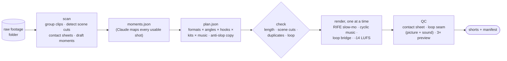

# loopa

[](https://github.com/aldhosutra/loopa/releases)
[](LICENSE)


**Read it "lupa"** (Indonesian for *forget*): forget hand-editing loops.

Drop your raw footage in a folder and ask Claude to loopa it. You get a batch of short videos
for TikTok, Reels and YouTube Shorts, each one a re-created edit rather than a trim, and every
one of them loops: when it replays, the last frame runs into the first and the music just keeps
going. No timeline, no keyframes, no hunting for a loop point.

## Why the loops actually loop

Most "seamless loop" edits match the first and last frame and then crossfade the soundtrack.
On a phone that sounds exactly like what it is: a cut, then a fade. loopa works **music-first**.

- **The soundtrack is a cycle, not a song.** It is composed as N whole bars: the drop lands
  on bar 1 together with the hook, and the last bar is a build (the kick drops out, a snare
  roll speeds up, the filter opens, the chords turn back home). Every replay hits like the
  drop again.
- **Tail-to-front, the game-audio technique.** Notes, effects, voice and reverb ring past
  the end, and that ring-out is laid over the start. The waveform is exactly periodic, with
  no crossfade and no fade anywhere.
- **The video is cut to the music.** Its length is exactly those bars. A bridge plays the
  footage from just *before* the opening shot, so the picture and the camera's own sound run
  straight into the first frame.
- **Container-exact.** The audio is 48 kHz and sample-locked to the frame count, and lengths
  snap to whole AAC blocks, so the encoder adds no padding (which plays as a click) at the
  seam.

## Installation

With the Skills CLI:

```bash
npx skills add aldhosutra/loopa --global
```

Leave off `--global` to install into the current project only.

Claude Code can install it as a plugin instead, which `/plugin update` then keeps current:

```text
/plugin marketplace add aldhosutra/loopa
/plugin install loopa@loopa
```

Or in one line, which can also set up the optional tools:

```bash
curl -fsSL https://raw.githubusercontent.com/aldhosutra/loopa/main/install.sh | bash -s -- --all
```

| flag | sets up |
|---|---|
| `--deps` | `~/.loopa/venv` with the renderer's Python packages (opencv, numpy, scipy, pillow) |
| `--with-rife` | AI slow motion: RIFE v4.26 frame generation on the GPU (ncnn/Vulkan), ~22 MB of models |
| `--with-tts` | Indonesian voice-over: Kokoro-82M via espeak-ng phonemes, plus faster-whisper to check what was heard |
| `--all` | all of the above |
| `--project` | install into `./.claude/skills` instead of `~/.claude/skills` |

Whichever route you use, run the doctor once:

```bash
~/.claude/skills/loopa/scripts/loopa doctor
```

**Needs** `ffmpeg` and Python 3.10+. Voice-over also needs `espeak-ng` (`brew install espeak-ng`).
Developed and tested on macOS (Apple Silicon). Linux should work but is untested.

**Fonts (optional).** The type kits look best with these free Google Fonts installed:
[Poppins](https://fonts.google.com/specimen/Poppins), [Fraunces](https://fonts.google.com/specimen/Fraunces),
[Urbanist](https://fonts.google.com/specimen/Urbanist), [Rubik](https://fonts.google.com/specimen/Rubik) and
[Manrope](https://fonts.google.com/specimen/Manrope). Any that are missing fall back to a system sans.

## Usage

Point it at a folder. Subfolders count as one video project each, and loose clips in the root
are grouped automatically by recording session and look:

```text
loopa ~/Videos/raw — make as many looping shorts as the footage supports
```

Ask for voice-over versions, a specific length, a compilation across folders, or "only 3
for now". It plans the batch, shows you the plan, renders one video at a time, checks every
render (including the loop seam in picture and sound) and hands you a `manifest_all.csv`
with captions and hashtags for posting.

## How it works



- **15 formats**: result-first recipe, POV story, velocity edit, satisfying loop, transformation
  with split screen, numbered list, myth vs fact, "guess what", ASMR, montage, timelapse with a
  footage-time counter, step counter, ranked compilation (it can mix folders), kinetic text story,
  and split screen.
- **Volume without duplicates**: one footage becomes many videos that differ in format, angle,
  first two seconds, copy, look and sound. The checker blocks near-duplicates, because platforms
  stop recommending accounts that repost the same thing.
- **Natural length**: 9–15 s for visual formats, which is the viral sweet spot, and 16–20 s for
  stories and lists. The ceiling is 30 s.
- **Slow motion that looks real**: every frame below 1× is a frame newly generated by RIFE, not a
  stretched 30 fps one. Fast ramps get shutter-style motion blur.
- **Anti AI-slop**: banned phrases, a one-emoji budget, effects only where something happens,
  type kits that rotate, and nothing claimed that the footage doesn't show.

## Checking a loop yourself

Player repeat modes (VLC and the like) reopen the file and add a hitch to *every* video, so
they can't show you a seamless loop. Do this instead:

```bash
~/.claude/skills/loopa/scripts/loopa preview video.mp4 3   # 3 plays back-to-back in one file
~/.claude/skills/loopa/scripts/loopa seam video.mp4        # seam score for picture and sound
```

The real test is a private upload ("Only me" on TikTok, Private or Unlisted on YouTube). Upload
the original file, and don't add in-app music or trim it, since either one breaks the loop.

## License

[MIT](LICENSE). Music and sound effects are synthesized by the skill itself, so there are no
samples to license. Third-party tools it can install (RIFE models, Kokoro, faster-whisper) keep
their own licenses.
